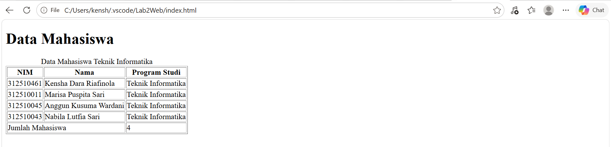
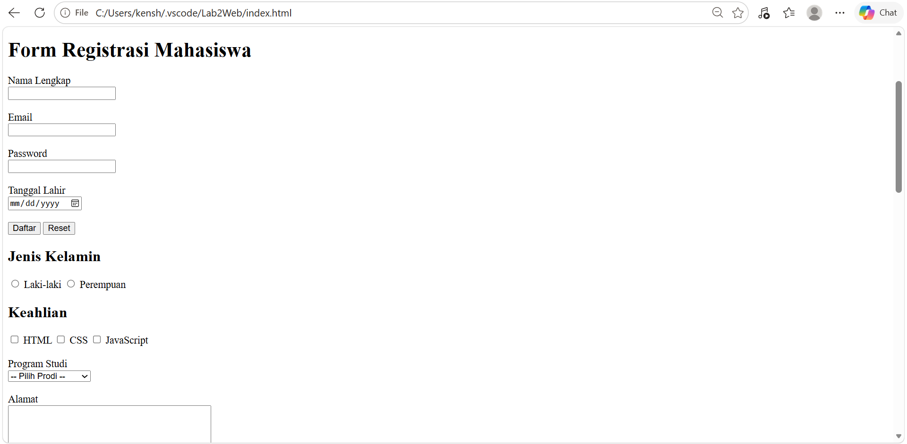
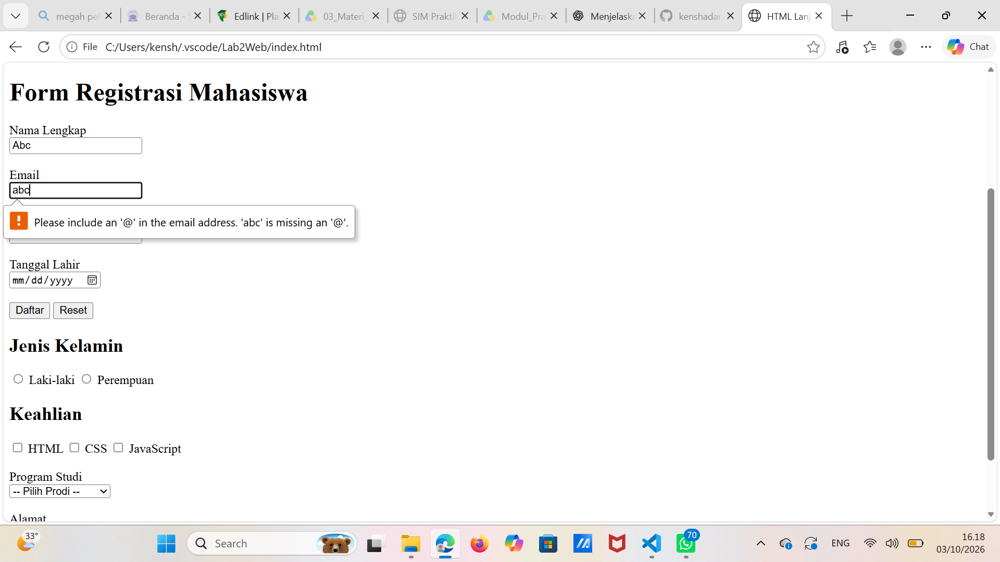
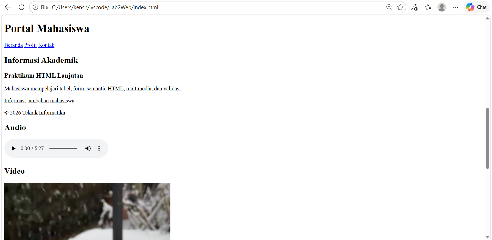
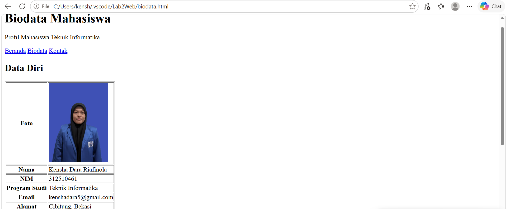
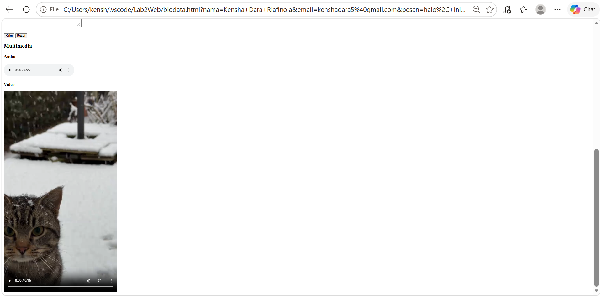

# Praktikum 2 - HTML Lanjutan

## Identitas

Nama: Kensha Dara Riafinola  
NIM: 312510461  
Program Studi: Teknik Informatika  
Universitas Pelita Bangsa

## Deskripsi

Praktikum 2 membahas HTML Lanjutan dengan materi tabel, form,
semantic HTML, multimedia, dan validasi form dasar.

## Materi yang Dikerjakan

### 1. Tabel HTML
Membuat tabel data mahasiswa menggunakan elemen table, tr, th, dan td.

### 2. Struktur Tabel
Mengembangkan tabel menggunakan caption, thead, tbody, tfoot,
dan colspan.

### 3. Form HTML
Membuat form registrasi dengan input text, email, password,
date, radio button, checkbox, select, dan textarea.

### 4. Validasi Form
Menerapkan validasi dasar menggunakan required dan minlength,
serta validasi email.

### 5. Semantic HTML
Menggunakan elemen header, nav, main, section, article,
aside, dan footer untuk menyusun halaman.

### 6. Multimedia
Menambahkan audio dan video menggunakan elemen audio dan video.

### 7. Proyek Mini Biodata
Membuat halaman biodata mahasiswa yang berisi data diri,
foto, informasi tentang diri, form kontak, audio, dan video.

## Struktur Folder

```text
Lab2Web/
├── index.html
├── biodata.html
├── foto.jpg
├── media/
│   ├── audio.mp3
│   └── video.mp4
├── screenshots/
│   ├── biodata.png
│   ├── form.png
│   ├── multimedia.png
│   ├── semantic.png
│   ├── table.png
│   └── validasi.png
└── README.md
```

## Hasil Praktikum

### 1. Tabel HTML



### 2. Form HTML



### 3. Validasi Form



### 4. Semantic HTML



### 5. Biodata Mahasiswa



### 6. Multimedia

